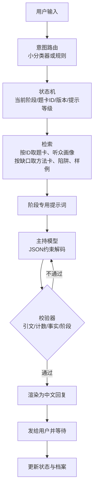

# 用小模型做独立表达训练师：可行性分析与落地方案

> 范围：评估能否把本仓库的表达逻辑训练范式（SKILL.md 及 references，含回声群岛、委托卡、快局、实验室、校准下注、陷阱图鉴、收束示范）交给一个 1B–14B 级开源模型独立主持，并给出可落地的技术组合、推荐路线和最小可行原型步骤。
> 性质：这是方案分析，不是实验结论。文中所有“能/不能”的判断都需要第 7 节的评估来验证；模型名以 Qwen3 系列为代表，执行时请换成同系列当时的最新版本。

## 0. 结论先行

1. **端到端地让一个小模型“读完 SKILL.md 然后自由主持”，不可行。** 全部规则和资料约 5–8 万 token，规则之间有大量“只在某条件下才做”的约束（一次一题、最多两处、只在原话有缺口时误读、首答前不给范文、提示加码但不降难度……）。7B 以下的模型在多轮对话里会明显漂移：一口气布置多个任务、夸一切或编造错误、提前给范文、收束示范里添加题卡没有的事实。你担心的“参数太小不懂如何回应”在这种用法下基本会发生。
2. **把主持拆开，让程序管流程、模型只管语言，8B–14B 级模型经过微调可以胜任大部分题卡训练。** 流程、阶段、提示等级、计数限制由代码里的状态机执行；每一步只让模型完成一个窄任务（复述、诊断、出一个追问、写示范），输出受 JSON schema 约束，再由校验器检查“引文是否真在原话里”“是否只有一个问题”等硬规则。这样小模型最弱的“长程自我约束”被交给代码，它只需要在短上下文里把一件事做好。
3. **最难、最依赖参数规模的是“诊断质量”**：判断一段话的推理是否跳步、哪个前提没说、哪里是真缺口而不是风格偏好。这一项 14B 明显好于 8B，8B 明显好于 3B；微调能缩小差距但无法完全追平大模型。缓解办法是题卡自带的 Focus/Probe（把开放诊断变成“对照检查”）加上针对误诊的偏好训练，以及低置信时回退到大模型。
4. **推荐路线**：Qwen3-14B（或 30B-A3B 的 MoE 版本，速度接近小模型）作为主持模型，LoRA SFT + DPO 两段微调，训练数据由大模型按本技能主持、模拟学习者对练合成；代码状态机 + JSON 约束解码 + 按题卡 ID 精确检索为主、向量检索为辅的 RAG + 规则校验器。本地 Mac 用量化版即可运行。资源紧时降到 8B，代价是诊断深度。
5. **最小可行原型**：先只做“灯塔岛”一个能力域（主旨先行，X01、S07—S12、两个快局），4–6 周可以拿到一个能本地跑、可与大模型盲测对比的版本，再决定是否扩到全部题库。

## 1. 这套范式对主持人要求什么

把 SKILL.md、session-protocol、rubric、world-atlas、quick-games、thinking-toolkit 中对主持人的要求拆成可测的能力项，并评估小模型的难度。

| # | 能力 | 规范里的具体要求 | 对小模型的难度 | 主要失败模式 |
|---|---|---|---|---|
| A | 流程控制与等待 | 出题→等待→诊断→一个追问→等待→重讲→比较→迁移→收束；每轮只有一个待完成动作 | 高（长程） | 一次发多题、跳阶段、自问自答替用户完成 |
| B | 状态跟踪 | 模式、情景ID、版本V1/V2、提示量H0—H4、当前重点、群岛档案 | 高（长程） | 忘记提示等级、把旧版本当新版本比较 |
| C | 精确复述 | “我听到的核心意思”一句话，不替用户补论据 | 中 | 顺手补全用户没说的理由；复述成教练自己的观点 |
| D | 误读回声 | 按听众画像扮演；只在原话有歧义、遗漏、跳步时误读，否则如实复述；可追溯到原话 | 中高 | 为戏剧效果编造误读；或从不误读 |
| E | 按维度诊断 | 六维 M/O/L/E/R/D（+P/S），0—2/N/A；引原句；最多一个内容问题 + 一个表达问题；没问题不制造问题 | **最高** | 夸一切（谄媚）；编造错误；把风格偏好当逻辑错；超过两处 |
| F | 提示阶梯 | 卡住或两版未改好：H1聚焦问题→H2关键词槽→H3局部开头；不降任务难度；回合中途不给H4 | 中（有规则即可） | 直接给答案；擅自把90秒改成30秒 |
| G | 收束示范 | 只用题卡事实和用户已说信息；自然口语、干练；附结构说明和与末版的一处关键差别 | 中 | 添加题卡没有的事实；书面腔；超长 |
| H | 角色切换 | 听众/评委与“教练反馈”分开标注；角色只用画像与题卡 | 中 | 角色口吻混进反馈；角色加戏 |
| I | 路由 | 识别“开始训练/快局/群岛模式/暂停/要范文/太难了”等意图 | 低 | 小分类问题，3B 即可 |
| J | 诚实边界 | 模态诚实（转写稿不评声音）、虚构标注、不编历史、不承诺效果 | 中 | 臆测声音、编造“上次你……” |
| K | 方法卡/陷阱图鉴 | 反馈后按需递一张方法卡；陷阱由用户自己命名，教练只核对证据 | 中 | 一次讲一堂理论课；替用户起名 |
| L | 中文表达质量 | 反馈 180—400 字，自然、不说教 | 低 | Qwen 系列中文足够 |

结论：A、B 交给代码后，小模型真正要扛的是 C、D、E、G 这四个“读懂一段话再精确回应”的能力，其中 E 是决定成败的核心。

## 2. 参数规模的现实预期

以下是基于同类任务经验的预估，需要用第 7 节的评测集验证。前提是已经采用第 3 节的“拆分式架构”；如果端到端主持，每一档都要再降一级。

| 规模 | 代表模型 | 能做好 | 主要短板 | 定位 |
|---|---|---|---|---|
| 0.5–3B | Qwen3-1.7B/4B、Gemma 3 1B/4B | 路由分类、格式化输出、照模板复述 | 诊断浅、常误判跳步、示范生硬 | 只做组件（意图分类、规则检查辅助） |
| 7–9B | Qwen3-8B、GLM-4-9B、MiniCPM 4 8B | 题卡内的复述、按 Focus 对照诊断、追问、提示阶梯、短示范 | 开放题目的推理诊断；隐含前提识别；长示范的事实一致性 | 资源紧时的主持模型 |
| 12–14B | Qwen3-14B、Gemma 3 12B | 以上全部，诊断明显更稳，误读回声更合理 | 用户自带的专业材料、复杂价值权衡（S79—S84、X12） | **推荐主持模型** |
| MoE 30B-A3B | Qwen3-30B-A3B | 质量接近或超过 14B，推理速度接近 3B | 显存/内存占用按 30B 算（Q4 约 18GB） | 内存够时的首选替代 |
| 27–32B | Qwen3-32B、Gemma 3 27B | 接近大模型的诊断 | 本地运行慢，部署成本高 | 作为本地“裁判”或难题回退 |

中文能力上优先 Qwen 系列；Llama 系列中文偏弱，不推荐作为主持基座。

## 3. 核心架构：程序管流程，模型管语言



### 3.1 状态机（代码实现，不靠模型记忆）

状态最小集合，与 SKILL.md“单轮控制与支架”一一对应：

```json
{
  "mode": "daily|short|quick_game|island|demo",
  "card_id": "X01",
  "stage": "brief|await_first|feedback|await_revision|compare|transfer|closing",
  "versions": [{"v": 1, "text": "...", "hint_level": 0}],
  "hint_level": 0,
  "same_issue_streak": 0,
  "focus": "主旨与请求先行",
  "listener": "港务长·韩",
  "echo_used_this_round": false,
  "open_task": "用30秒重讲，把请求放进第一句"
}
```

关键规则写成代码而不是提示词：
- 每个阶段只允许一种输出类型（出题阶段不允许出现评价字段，`await_*` 阶段必须停下）。
- `same_issue_streak >= 2` 时 `hint_level` 只能加一级，且任务时长、听众、材料量不得改变；H4 只在 `closing` 或用户明确要求范文时允许。
- `echo_used_this_round` 保证每轮最多一次误读回声。
- 用户说“暂停/结束/换题/关掉剧情/太难了”时由路由直接改状态，不交给模型判断。
- 对话历史不整段塞回模型，每轮只传：状态 JSON + 当前题卡 + 用户最近两版原文 + 必要检索片段。上下文控制在 4k–8k token，这是小模型保持稳定的关键。

### 3.2 阶段专用的结构化输出

反馈轮让模型输出 JSON，再由代码拼成“四部分反馈”。示例 schema（节选）：

```json
{
  "type": "object",
  "required": ["restatement", "keep", "issues", "next_step"],
  "properties": {
    "restatement": {"type": "string", "maxLength": 80},
    "keep": {
      "type": ["object", "null"],
      "properties": {"quote": {"type": "string"}, "why_it_helps": {"type": "string"}}
    },
    "issues": {
      "type": "array", "maxItems": 2,
      "items": {
        "type": "object",
        "required": ["kind", "dimension", "quote", "gap", "action"],
        "properties": {
          "kind": {"enum": ["content_logic", "organization_wording"]},
          "dimension": {"enum": ["M", "O", "L", "E", "R", "D", "P", "S"]},
          "quote": {"type": "string"},
          "gap": {"type": "string"},
          "action": {"type": "string"}
        }
      }
    },
    "next_step": {
      "type": "object",
      "required": ["kind", "text"],
      "properties": {
        "kind": {"enum": ["one_question", "retell_one_part"]},
        "text": {"type": "string"}
      }
    },
    "diagnosis_notes": {"type": "string", "description": "隐藏的简短推理，不展示给用户"}
  }
}
```

要点：
- `issues` 用 `maxItems: 2` 和两个 `kind` 枚举直接在解码层保证“最多一个内容问题 + 一个表达问题”。允许空数组，配合训练数据让模型学会“没发现就说没发现”。
- 把 `diagnosis_notes` 放在最前面生成（字段顺序决定生成顺序），相当于让小模型先想后说；Qwen3 的思考模式也可起同样作用，但要限制长度。
- 约束解码工具：服务器端用 vLLM 的 guided decoding（xgrammar/outlines 后端）或 SGLang；本地用 llama.cpp 的 JSON schema/GBNF 语法，Ollama 的 `format` 参数也支持 JSON schema。约束解码只保证格式，不保证内容，内容靠下面的校验器。

### 3.3 校验器（便宜但最有效的一层）

| 检查 | 方法 | 不通过时 |
|---|---|---|
| 引文真实 | `quote` 必须是用户原文的子串（允许标点差异的模糊匹配） | 重新生成该字段 |
| 只有一个待完成动作 | `next_step.text` 中问号/祈使句计数，拒绝“并且再……” | 重新生成 |
| 首答前不泄露 | 出题阶段输出与题卡 Focus/Probe/Transfer 的相似度阈值 | 丢弃重来 |
| 收束示范不加事实 | 抽取示范中的数字、时间、实体，必须能在题卡 Facts 或用户原文里找到；可再加一个小型 NLI 检查 | 重新生成 |
| 长度 | 反馈 180—400 字；示范按任务时长估算字数（约每分钟 200—250 字） | 截断或重写 |
| 阶段合规 | 输出类型与状态机当前阶段一致 | 重来 |
| 模态诚实 | 无音频时 `dimension` 不得为 D | 删除该条 |

重试两次仍不通过，可以回退到模板化回复或调用大模型（见 6.3 混合路由）。

## 4. RAG：大部分检索应该是“查表”而不是“语义搜索”

本技能的资料只有约 230KB，规模很小，真正需要的是在正确的时刻把正确的那一小块放进上下文。

### 4.1 先把资料结构化

写一个转换脚本，把 Markdown 变成 JSON 记录（这一步本身也能发现题卡里的缺漏）：

| 库 | 来源 | 记录字段 | 取用方式 |
|---|---|---|---|
| 题卡库 | scenarios-*.md、scenarios-world.md、scenarios-work.md | id、role、audience、facts、task、stakes、success、focus、probes[]、transfer、variant | 状态机按 `card_id` 精确取 |
| 听众画像 | world-atlas.md 听众图鉴 | 名称、已知/不知、想得到、注意力、典型误读、能打动他的 | 按 `listener` 精确取 |
| 快局规则 | quick-games.md | 编号、玩法分步、揭示、计分、防偏 | 按 G 编号取当前一步 |
| 方法卡 | thinking-toolkit.md T01—T12 | 何时递出、启动问题、常见误用 | 按诊断出的缺口类型语义检索 |
| 语言/叙事/逻辑实验室条目 | language-lab、narrative-lab、logic-lab、concept-lab | 现象、例句、修改动作 | 按缺口语义检索 |
| 评分锚点 | rubric.md | 维度 × 0/1/2 描述 | 按维度精确取 |
| 反馈样例 | feedback-examples.md + 合成的优质样例 | 情境、用户原话、合格回应、不合格回应、原因 | 语义检索 1—2 条做少样本 |
| 个人陷阱图鉴 | 用户自己的 trap-journal | 名字、原句证据、自查问题 | 每次反馈前取活跃条目 |
| 续练卡/档案 | 用户历史 | 上次重点、提示量、能力地图 | 会话开始时取 |

### 4.2 检索策略

- **精确查表**：题卡、听众、快局步骤、评分锚点。状态机知道当前 ID，不需要向量检索，也就不会取错卡。
- **混合检索**（BM25 + 向量，中文嵌入可用 bge-m3 或 bge-small-zh）：方法卡、实验室条目、反馈样例。查询文本用模型第一步诊断出的 `gap` 字段，而不是用户原话，命中率更高。取 top-1 或 top-2 即可，多了反而干扰小模型。
- **用户自带题目**：先检索最相近的题卡作为“结构模板”（如汇报类→S07—S12 的 Focus），再让模型按模板生成新卡，并标注“训练设定”。
- 检索内容放在提示词固定位置（`<card>`、`<listener>`、`<tool>` 标签），训练数据也用同样位置，模型才学得会“依据这里的事实”。

## 5. 提示词工程：给小模型的提示要短、分阶段、可复用

1. **一份 1000–1500 token 的“主持宪法”**，从 SKILL.md 提炼出不可违反的规则（一次一题、引原话、最多两处、不造错误、不降难度、模态诚实、虚构标注、尊重暂停）。只放规则，不放解释和依据。
2. **每个阶段一份短提示**：出题、误读回声、反馈诊断、提示 H1/H2/H3、重讲比较、迁移出题、收束示范、快局各步。每份只描述当前这一步要输出什么、不许输出什么。小模型对“当前只做一件事”的服从度远高于对长规则表的服从度。
3. **正面指令优先**：把“不要一次布置多个任务”改写成“只写一个问题，写完就停”。否定句堆叠会让小模型更容易出错。
4. **少样本取 1—2 条最相近的样例**（来自 4.2 检索），包含一个“合格”和一个“不合格及原因”。
5. **把关键约束放在提示末尾重复一次**（近因效应），例如“issues 至多 2 条；原话里没有问题就返回空数组”。
6. **微调后提示词可以继续缩短**：SFT 让模型内化流程后，宪法可以压到几百 token，节省上下文给题卡和用户原文。但训练和推理时的提示格式必须一致。

## 6. 数据构造与微调

### 6.1 合成对话：大模型当老师，另一个大模型扮学习者

**老师（主持人）**：用强大模型（如 Claude）加载完整 SKILL.md 主持。这就是你现在的体验，质量上限即老师水平。

**学习者模拟器**：另一路大模型按“学习者画像”作答，画像从陷阱和题卡 Focus 里系统生成，保证覆盖面：

| 维度 | 取值示例 |
|---|---|
| 水平 | 新手（结论埋在后面、循环定义）／中等（结构对但缺条件）／熟练（基本没问题，只有细节） |
| 典型失误 | 请求缺失、主旨后置、因果跳步、以偏概全、指代不清、零主语、术语未解释、稻草人复述、过度确定、过度含糊 |
| 对话行为 | 正常作答、答非所问、说“我不会”、要范文、中途暂停、要求关掉剧情、反驳教练、合理改变观点 |
| 模态 | 文字、转写稿（用于训练“不评声音”） |

**必须包含“表现很好的学习者”**，比例约 15%–20%，否则学生模型会学成“每次必须找两个错”。

**规模建议**：

| 阶段 | 题卡范围 | 对话数 | 拆成阶段样本 |
|---|---|---|---|
| MVP | 灯塔岛：X01、S07—S12、W01—W03、G03/G05 | 800—1500 | 约 1 万条 |
| 全量 | 84 张 S 卡 + 12 W + 12 X + 12 快局 + 实验室 | 4000—8000 | 5—10 万条 |

**拆成阶段样本**：一段完整对话按状态机切成“输入=状态+检索片段+用户原文，输出=该阶段 JSON”的独立样本。这样训练数据和推理时的输入格式完全一致，也方便按阶段补数据。

**质量过滤**：
- 先跑第 3.3 节的规则校验器，不合格直接丢。
- 再用大模型裁判按 qa-cases.md、world-qa.md、evening-qa.md 的“应出现/不应出现”逐条打分，只保留高分样本。
- 每 200 条人工抽查 10 条，重点看诊断是否真实、示范是否加了事实。

**真实数据**：你自己用 Claude 主持练习的记录是最有价值的种子，能反映真实的失误分布。征得自己同意后保存（脱敏），按同样格式加入，权重可以调高。

### 6.2 微调路线

| 阶段 | 方法 | 数据 | 关键设置 | 目的 |
|---|---|---|---|---|
| 0 | 不微调：状态机 + 提示 + RAG + 校验器 | — | — | 先量出基线和与老师的差距，决定是否值得微调 |
| 1 | LoRA SFT（或 QLoRA） | 阶段样本 + 10%–20% 通用中文对话防遗忘 | rank 16—64，作用于全部线性层，学习率 1e-4—2e-4，2—3 个 epoch | 学会流程、格式、语气和题卡用法 |
| 2 | DPO（或 SimPO/KTO） | 同一输入下的优劣回复对 | β≈0.1，1 个 epoch | 专门压住失败模式 |
| 3（可选） | GRPO 等强化学习 | 规则奖励 + 裁判奖励 | 小学习率，KL 约束 | 进一步提高硬约束通过率与诊断准确度 |

**DPO 偏好对怎么来**：用阶段 1 的学生模型对同一输入采样 4—8 个回复（on-policy），由裁判挑出最好与最差；再补充一部分人工构造的“典型坏回复”。重点覆盖：

- 谄媚（原话有明显缺口却说“很好”） vs 准确指出
- 编造错误（原话没问题却挑两处） vs 如实说“这一类未发现”
- 一次布置三个任务 vs 只留一个动作
- 卡住时降低难度 vs 保持难度、加 H1/H2 提示
- 首答前给范文 vs 等待首答
- 收束示范添加新事实 vs 只用题卡事实
- 误读回声凭空加戏 vs 可追溯到原话
- 把风格偏好当逻辑错误 vs 区分事实错误、推理缺口、结构障碍、风格偏好

**诊断蒸馏**：让老师在生成数据时同时输出简短的诊断推理（对应 `diagnosis_notes`），学生学“先想再说”。推理长度控制在 100—200 字，过长会拖慢本地推理。

**工具**：LLaMA-Factory、ms-swift、Unsloth、TRL 均支持 Qwen 系列的 LoRA SFT/DPO。

### 6.3 混合路由：小模型主持，大模型兜底

完全独立是目标，但在以下情况回退到大模型 API 会显著提升体验，可作为可选开关：
- 校验器两次重试仍不通过；
- 用户自带专业材料或现实事实需要核查（SKILL.md 要求标“待核实”或查来源）；
- 综合价值权衡类题卡（S79—S84、X12）；
- 学生模型对诊断的自评置信度低（可在 schema 里加一个 `confidence` 字段，并在训练中用裁判结果校准它）。

关掉这个开关就是纯本地运行；回退日志同时是下一轮微调最有价值的数据。

## 7. 评估方法

### 7.1 评测集（先建再训）

- **留出题卡**：随机留出约 15% 的题卡和 2 类学习者画像完全不进训练，检验迁移而不是背题。
- **诊断金标集 200 条**：对灯塔岛等题卡人工（或大模型 + 人工复核）写学习者答案，其中约 150 条各植入 1—2 个已知缺陷（标注维度和原句），约 50 条是没有明显问题的好答案。用于计算诊断的命中率和“造错率”。
- **多轮会话剧本 50 段**：每段 15—25 轮，含暂停、要范文、太难了、关剧情、反驳等分支，检验状态不漂移。

### 7.2 指标与建议门槛

| 类别 | 指标 | 计算 | 建议门槛（MVP） |
|---|---|---|---|
| 硬约束 | 格式合法率、引文真实率、单动作率、首答前不泄露率、示范事实一致率 | 规则自动判 | 校验器后 ≥99%，校验器前 ≥90% |
| 诊断 | 缺陷命中率（召回）、指出问题中真实问题的比例（精确率）、好答案上的造错率 | 金标集 | 召回 ≥75%，精确 ≥80%，造错率 ≤10% |
| 复述 | 复述是否忠实、是否补出用户没说的论据 | 裁判 + 抽检 | 忠实 ≥90% |
| 误读回声 | 误读是否可追溯到原话 | 裁判 + 抽检 | ≥90% |
| 收束示范 | 自然度、简洁度、结构说明是否成立 | 与老师示范两两盲比 | 胜+平 ≥60% |
| 整体 | 整轮主持质量 | 与老师整段对话两两盲比（裁判） | 胜+平 ≥50% |
| 体验 | 你本人盲测 | 同一题卡由学生/老师主持，隐去来源后打分 | 你愿意日常使用 |

裁判模型有偏好长回复、偏好自己风格的倾向：两两比较时交换顺序各跑一次，并固定长度上限。

## 8. 部署与成本（量级估算，执行前按当时价格核实）

**本地运行（推荐先在你的 Mac 上）**
- 14B 用 Q5_K_M 量化约 10GB，16GB 统一内存可跑但偏紧，24GB 以上更稳；Apple M 系列上约每秒 15—30 个汉字级 token，一次 300 字反馈数秒到十几秒。
- 8B 用 Q5_K_M 约 6GB，速度约翻倍。
- 30B-A3B 用 Q4 约 18GB，需要 32GB 内存，但生成速度接近 3B。
- 运行时：Ollama 或 llama.cpp（都支持 JSON schema 约束）；量化会削弱指令服从，14B 不建议低于 Q4_K_M，评测要在量化后的版本上做。
- 前端：先用命令行或 Gradio/Streamlit 简单网页，状态与档案存本地 JSON/SQLite。

**训练**
- QLoRA 微调 14B：单张 24GB 显卡（如 4090）可行；8B 在 16GB 卡上可行。云上租一张 A100/H100，MVP 规模几小时内完成，费用通常在几十美元量级。
- DPO 与 SFT 成本相近。

**数据合成**
- 主要成本是大模型 API。MVP 约 1000 段对话、全量约 5000 段，每段十几轮，系统提示约 1 万 token。启用提示缓存和批量接口可以明显降低费用。量级大致是 MVP 百美元级、全量数百到一两千美元，具体按所选模型的当时价格核算。
- 裁判打分的调用量与合成相当，可用较便宜的模型做初筛、强模型做复核。

**服务器部署（可选）**：vLLM/SGLang + xgrammar 约束解码，一张 24GB 卡可服务 14B 的少量并发用户。

## 9. 主要风险与对策

| 风险 | 表现 | 对策 |
|---|---|---|
| 诊断质量不足 | 漏掉真正的推理缺口，或挑出不存在的问题 | 题卡 Focus/Probe 做对照检查；DPO 专项；金标集持续监控；低置信回退 |
| 学会“老师的口头禅” | 每次反馈句式一样，像模板 | 合成时让老师在同一结构内变换表达；SFT 数据去重；加少量多样性奖励 |
| 模拟学习者不像真人 | 合成失误过于典型，真实用户的说法训练里没见过 | 加入你的真实记录；画像里加入口语化、跑题、半截话 |
| 量化后退化 | 本地版本比评测时差 | 只在最终量化版上评测与验收 |
| 现实事实错误 | 解释机制、专业概念时说错 | 优先用群岛虚构设定；现实知识类题目开启回退或标“待核实” |
| 维护成本 | 改了 SKILL.md 后小模型不同步 | 题卡/规则从 Markdown 自动转 JSON；规则改动先改状态机和校验器，再增量补数据微调 |
| 过度依赖评分 | 小模型给出看似精确的 0/1/2 | 日常不展示分数；分数只在周测时出现，且必须附原句 |

## 10. 推荐路线

| 组件 | 选择 | 理由 |
|---|---|---|
| 主持模型 | Qwen3-14B（内存够则 Qwen3-30B-A3B），LoRA 微调 | 中文好、诊断质量与本地可运行性的平衡点 |
| 路由 | 规则 + 小模型分类（可用同一模型的短提示，或 1.7B 级专用分类器） | 意图有限，确定性优先 |
| 流程 | 代码状态机 | 把小模型最弱的长程约束移出模型 |
| 输出 | JSON schema 约束解码 + 规则校验器 + 代码渲染 | 硬规则在解码层和校验层双重保证 |
| 知识 | 结构化题卡/画像/规则库，按 ID 精确取；方法卡与样例混合检索 | 资料小，精确优先 |
| 微调 | SFT → DPO，可选 GRPO | SFT 学流程，DPO 压失败模式 |
| 兜底 | 可开关的大模型回退 | 保证难题体验，回退日志反哺训练 |
| 部署 | Mac 本地 Ollama/llama.cpp，Q5 量化 | 零服务费，隐私留在本地 |

## 11. 最小可行原型（MVP）步骤

范围只限灯塔岛：X01、S07—S12、W01—W03、快局 G03（预设拆弹）与 G05（量级侦探），覆盖出题、误读回声、反馈、提示阶梯、重讲比较、迁移、收束示范全流程。

| 周 | 产出 | 完成标准 |
|---|---|---|
| 第 1 周 | 资料结构化脚本（题卡/听众/快局/方法卡 → JSON）；“主持宪法”与各阶段提示词；状态机与校验器代码骨架 | 能用命令行走完一张卡的全流程（模型暂用 API 大模型代替） |
| 第 1—2 周 | 评测集：诊断金标 200 条、会话剧本 30 段；自动评测脚本 | 用老师模型跑一遍得到“上限分数” |
| 第 2 周 | 基线：未微调的 Qwen3-8B 与 14B 接入同一套架构 | 得到与老师的差距表，确定主攻能力项 |
| 第 2—3 周 | 合成 1000—1500 段对话，过滤后拆成阶段样本 | 规则通过率 100%，裁判高分样本 ≥70% |
| 第 3—4 周 | LoRA SFT → 评测 → 收集失败案例 → DPO → 评测 | 达到第 7.2 节 MVP 门槛，或明确离门槛还差什么 |
| 第 4—5 周 | 量化到 Q5，本地 Ollama 运行；简单网页界面；你盲测 10 次以上 | 你愿意用它做日常练习；记录所有不满意的回合 |
| 第 5—6 周 | 用盲测反馈和回退日志补数据，再训一轮；决定是否扩展到其他岛 | 有明确的“扩不扩、换不换模型规模”的结论 |

**第一步可以马上做的事**：把 scenarios-world.md 和 scenarios-02.md 转成 JSON，并写出反馈阶段的 schema 和引文校验。这两件事不依赖任何模型选择，做完就能用现在的 Claude 主持生成第一批种子数据，同时检验题卡本身是否足够结构化。

## 12. 尚未确定、需要你决定的事

- 运行环境：只在你自己的 Mac 上本地跑，还是需要手机/多人访问（决定是否要服务器部署）。
- 是否接受“大模型兜底”开关，还是必须纯离线。
- 是否愿意把自己的练习记录（脱敏后）用作训练数据，这是提升真实感最有效的数据来源。
